<div dir="rtl">

# סיכומי וואטסאפ

תוכנה ל-Windows שקוראת את שיחות הוואטסאפ שלך (**קריאה בלבד**), שומרת אותן **רק במחשב שלך**, ומסכמת בשבילך את הקבוצות והשיחות שבחרת: מה החליטו, מה צריך לעשות, אילו אירועים קובעים, ומה בן/בת הזוג ביקש/ה ממך. אפשר לראות הכול גם בטלפון ולקבל סיכום יומי לטלגרם.

<p align="center">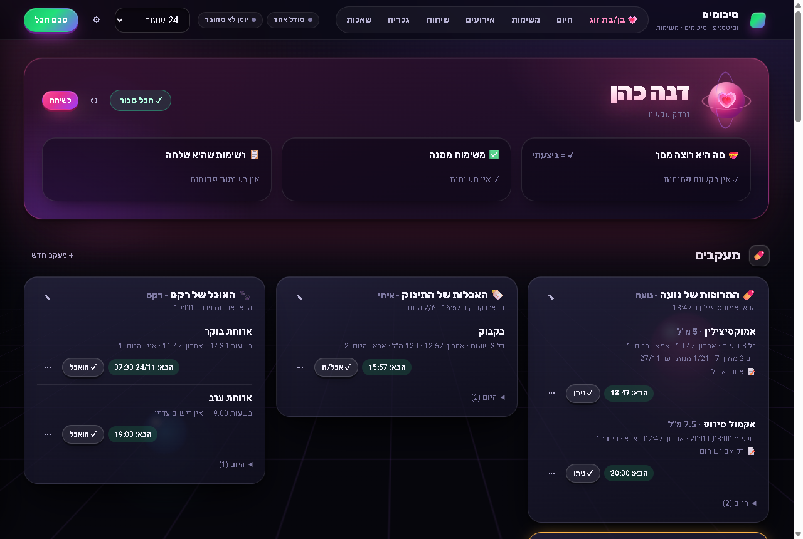</p>

> כל התמונות במדריך הזה הן **דוגמה עם שמות ומספרים בדויים**. התמונות של וואטסאפ וטלגרם הן איורים להמחשה, לא צילומי מסך של האפליקציות האמיתיות.

## מה התוכנה עושה

- **סיכום של קבוצות:** במקום לקרוא 200 הודעות בקבוצת ההורים, רואים 4 שורות: מה קורה, מה צריך לשלם, מתי האסיפה.
- **משימות ואירועים:** התוכנה מזהה "צריך להביא…", "אסיפה ביום חמישי ב-19:00", ומציגה אותם במקום אחד.
- **בן/בת הזוג:** כרטיס מיוחד שעוקב אחרי מה שביקשו ממך, רשימות קניות ושאלות שמחכות לתשובה.
- **מעקבים:** תרופות לילד חולה (מה הרופא נתן ומתי המנה הבאה), האכלת תינוק, האכלת כלב, השקיית צמחים. עם תזכורות.
- **שאלה חופשית:** "מתי הטיול השנתי?" והתוכנה מחפשת בשיחות ועונה.
- **בטלפון ובטלגרם:** פותחים את התוכנה מהטלפון מכל מקום, ומקבלים סיכום יומי ותזכורות לטלגרם.

**מה התוכנה לא עושה:** היא לא שולחת הודעות בוואטסאפ, לא מוחקת, ולא משנה כלום בטלפון. היא רק קוראת.

---

## לפני שמתחילים

- מחשב עם **Windows 10 או 11**.
- **וואטסאפ בטלפון** (התוכנה מתחברת אליו כמו "וואטסאפ ווב").
- כדי שהסיכומים יעבדו צריך "מוח" (מודל AI). יש שתי אפשרויות, ובשתיהן התוכנה מסבירה בדיוק מה ללחוץ:
  - **מודל שרץ על המחשב שלך** (מומלץ, הכי פרטי): צריך כרטיס מסך טוב או הרבה זיכרון. התוכנה בודקת לבד אם המחשב מתאים.
  - **שירות בענן** (למשל Google Gemini): עובד בכל מחשב, צריך "מפתח" חינמי מהאתר שלהם.

## שלב 1: הורדה והתקנה

1. נכנסים לדף **[Releases](../../releases/latest)** של הפרויקט.
2. מורידים את הקובץ **`WhatsApp-Summary-Setup-…exe`**.
3. לוחצים עליו פעמיים. ההתקנה לוקחת כמה שניות ולא צריך הרשאות מנהל.
4. אם מופיע חלון כחול של Windows שאומר **"Windows protected your PC"**: לוחצים על **More info** (מידע נוסף) ואז על **Run anyway** (הפעל בכל זאת). זה קורה כי התוכנה חדשה ולא חתומה דיגיטלית, לא כי יש בה בעיה.
5. בסוף ההתקנה התוכנה נפתחת לבד, ונוצר אייקון על שולחן העבודה.

התוכנה **עולה לבד עם Windows** וממשיכה לעבוד ברקע גם כשסוגרים את החלון (יש לה אייקון קטן ליד השעון). כך היא לא מפספסת הודעות.

## שלב 2: חיבור לוואטסאפ

בפעם הראשונה התוכנה מבקשת את מספר הטלפון שלך ומציגה **קוד של 8 תווים**.

<p align="center">
  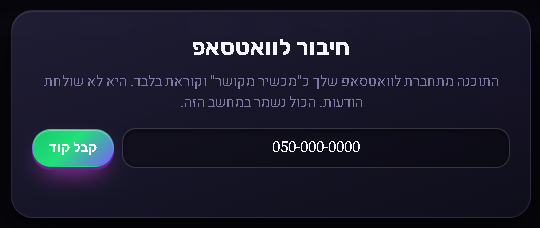
  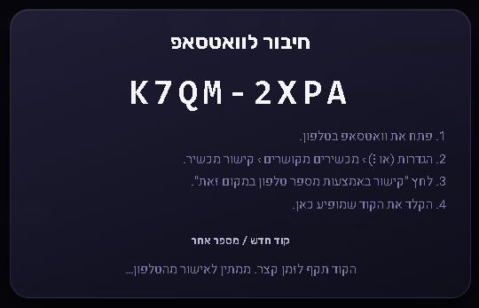
</p>

עכשיו בטלפון:

1. פותחים את **וואטסאפ**.
2. נכנסים ל**הגדרות** (באייפון: למטה מימין. באנדרואיד: שלוש הנקודות ⋮ למעלה) ← **מכשירים מקושרים** ← **קישור מכשיר**.
3. בתחתית המסך שנפתח לוחצים על **"קישור באמצעות מספר טלפון במקום זאת"**.
4. מקלידים את הקוד שמופיע במחשב.

<p align="center">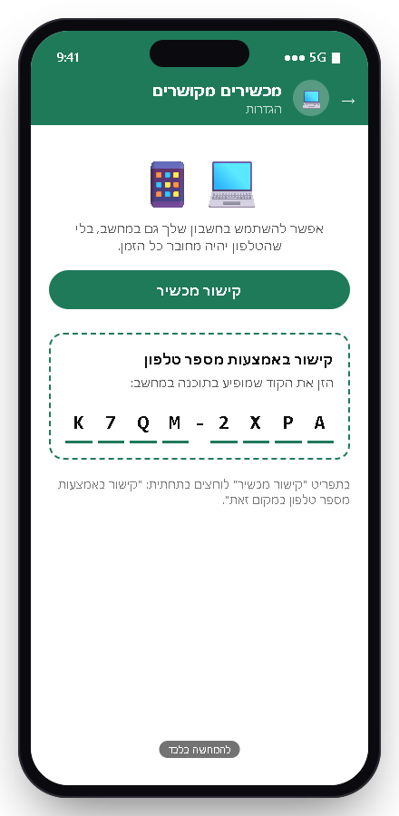</p>

אחרי כמה שניות התוכנה כותבת **"מחובר"** ומתחילה להוריד את היסטוריית השיחות. **השאירו את התוכנה פתוחה** עד שהמונה מפסיק לעלות: וואטסאפ שולח את ההיסטוריה פעם אחת בלבד.

> כדי לנתק את התוכנה בכל רגע: בטלפון, **מכשירים מקושרים** ← לוחצים על המחשב ← **התנתקות**.

## שלב 3: בוחרים אילו שיחות לסכם

ברשימת **"כל השיחות"** (בתחתית המסך הראשי) מסמנים ✓ ליד הקבוצות והשיחות שרוצים לעקוב אחריהן. לכל שיחה אפשר לבחור מה לקרוא: טקסט, הקלטות, תמונות וקישורים.

<p align="center">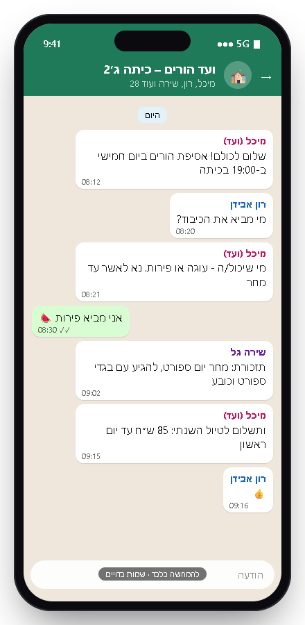</p>

כך נראית אותה קבוצה בתוכנה, אחרי הסיכום:

<p align="center">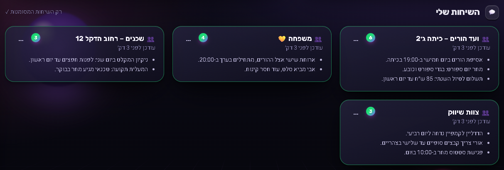</p>

שיחות שלא סימנתם לא נמחקות מיד: הטקסט שלהן נשמר בארכיון במחשב ל-30 יום, כך שאם תסמנו שיחה מאוחר יותר, היא מתחילה עם היום האחרון שלה.

## שלב 4: בוחרים את "המוח" (מודל AI)

לוחצים על **⚙** (הגדרות) למעלה ← **מודלים מקומיים**.

<p align="center">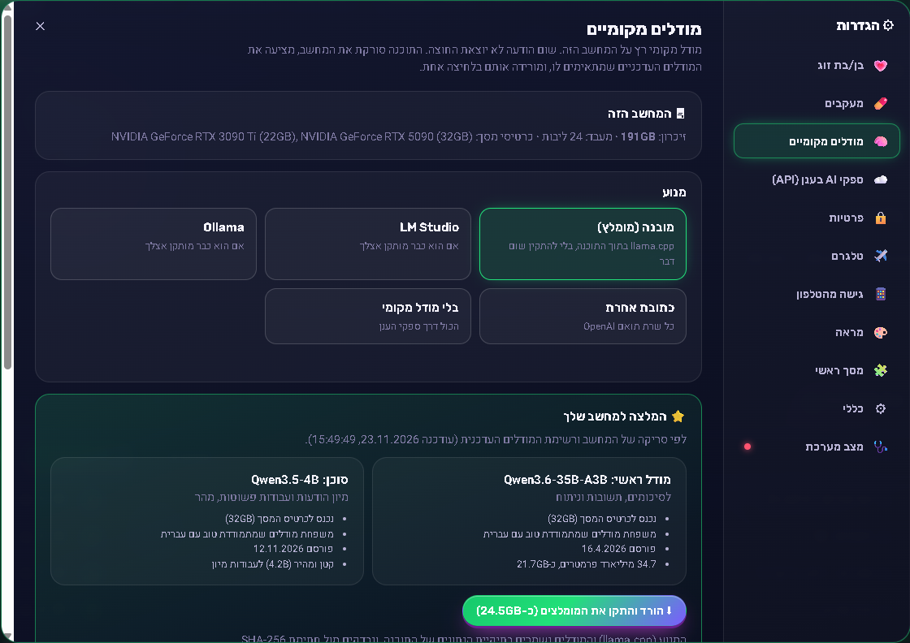</p>

**האפשרות הפשוטה ביותר:** התוכנה סורקת את המחשב, ממליצה על המודלים שמתאימים לו, ויש כפתור אחד: **"הורד והתקן את המומלצים"**. היא מורידה הכול לבד, למקום הנכון, ובודקת שהקבצים תקינים. ההורדה גדולה (כמה GB), אז כדאי חיבור אינטרנט טוב. אפשר להמשיך לעבוד בזמן ההורדה.

> בתמונה: מחשב חזק במיוחד. במחשב רגיל יוצעו מודלים קטנים יותר. אחרי ההורדה אפשר ללחוץ **"בדיקה בעברית"** כדי לראות שהמודל מבין עברית טוב.

**אם המחשב חלש** (אין כרטיס מסך): משתמשים בשירות ענן. בהגדרות ← **ספקי AI בענן** ← בוחרים ספק (למשל Google Gemini), מדביקים את המפתח, לוחצים **בדוק** ואז **שמור**. ליד כל ספק כתוב איפה מקבלים מפתח.

<p align="center">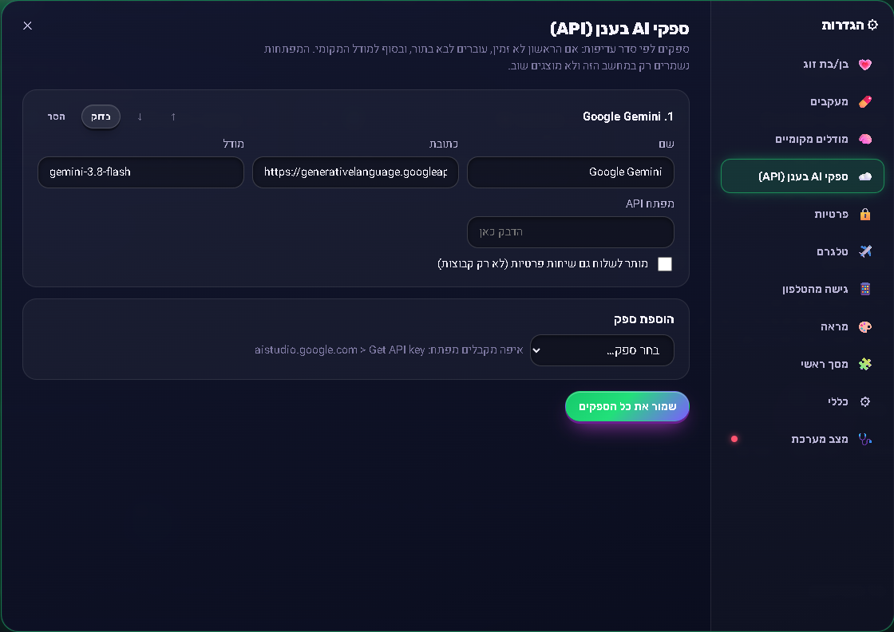</p>

## שלב 5: בן/בת הזוג

הגדרות ← **בן/בת זוג**. בוחרים את לשון הפנייה (**בן זוג** או **בת זוג**), מקלידים כמה אותיות מהשם כפי שהוא שמור אצלך בוואטסאפ, ובוחרים מהרשימה.

<p align="center">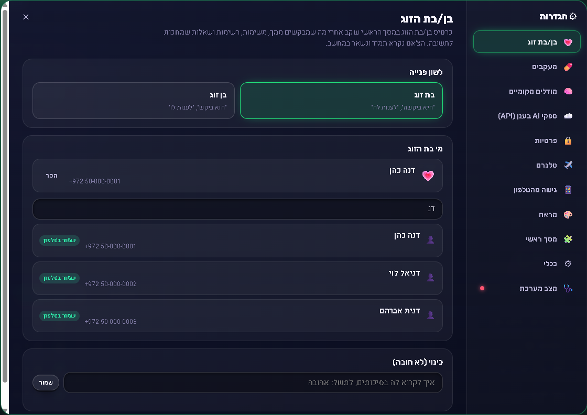</p>

מעכשיו בראש המסך מופיע כרטיס שאומר מה ביקשו ממך, אילו משימות פתוחות, ואם מחכים לתשובה ממך.

## שלב 6: מעקבים (תרופות, האכלה, צמחים)

הגדרות ← **מעקבים** ← בוחרים סוג: **תרופות**, **האכלת תינוק**, **חיית מחמד**, **צמחים** או **תזכורת קבועה**. אפשר להוסיף כמה מעקבים שרוצים.

- **תרופות לילד חולה:** מכניסים כל מה שהרופא נתן: שם התרופה, המינון, כל כמה שעות (או בשעות קבועות), ממתי וכמה ימים. התוכנה מראה מתי המנה הבאה ובאיזה יום של הטיפול אתם.
- **האכלת תינוק:** אפשר לרשום כמות ומי האכיל. אם בבית כותבים את הארוחות בקבוצת וואטסאפ ("אכל 120 ב-14:30"), מחברים את הקבוצה והרישום נעשה לבד.

<p align="center">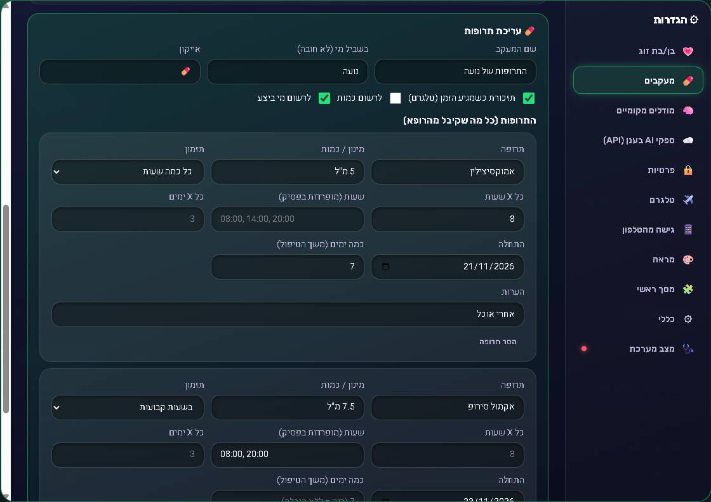</p>

במסך הראשי כל מעקב הוא כרטיס עם הזמן הבא וכפתור **"✓ ניתן"** (או "הואכל" / "הושקה"). לחיצה רושמת את השעה עכשיו. ב-**⋯** אפשר לרשום שעה אחרת, כמות ומי.

<p align="center">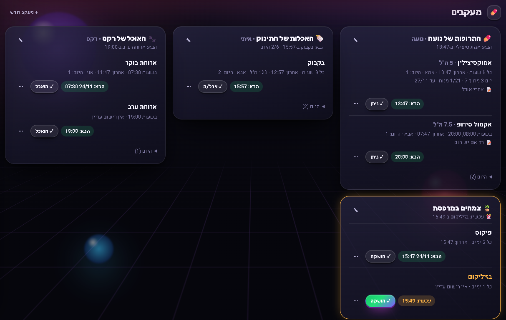</p>

כמה דברים חשובים:
- אם שני ההורים לחצו על אותה מנה, היא **נרשמת פעם אחת** בלבד.
- אם הגיע זמן ולא נרשם כלום, כתוב **"אין רישום"**, לא "לא ניתן". אולי נתתם ופשוט לא סימנתם.
- כשמגיע זמן של מנה, נשלחת תזכורת לטלגרם (אם חיברתם, בשלב הבא).

## שלב 7: טלגרם (לא חובה)

לקבלת **סיכום יומי** (בשעה 20:00, אפשר לשנות) ו**תזכורות** לטלפון. יוצרים "בוט" אישי בטלגרם. זה לוקח שתי דקות:

1. בטלגרם מחפשים **@BotFather** (עם וי כחול) ופותחים איתו שיחה.
2. שולחים לו **`/newbot`**.
3. הוא מבקש שם: כותבים כל שם, למשל "הסיכומים שלי".
4. הוא מבקש שם משתמש באנגלית שמסתיים ב-**bot**, למשל `my_summaries_4821_bot`.
5. הוא שולח שורה ארוכה שנקראת **token** (טוקן). מעתיקים אותה.

<p align="center">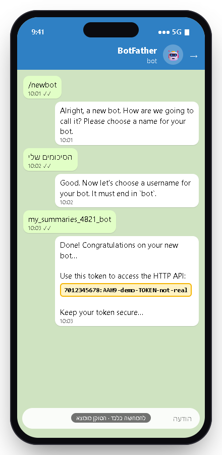</p>

6. בתוכנה: הגדרות ← **טלגרם** ← מדביקים את הטוקן ולוחצים **שמור**.
7. מופיע קוד, למשל `/start 482913`. פותחים בטלגרם את הבוט שיצרתם ושולחים לו את הקוד. **רק מי ששולח את הקוד** מקבל את הסיכומים, כך שאף אחד אחר לא יכול להשתמש בבוט שלך.

<p align="center">
  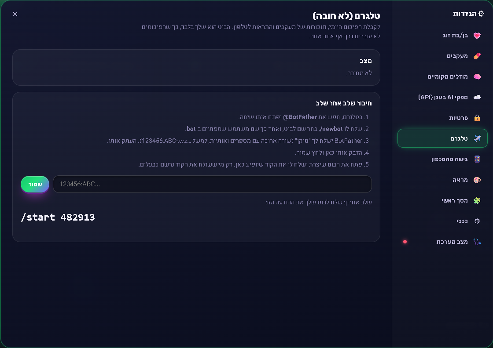
  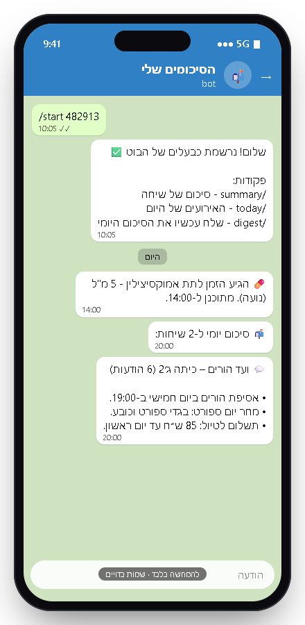
</p>

## שלב 8: לראות את התוכנה בטלפון

אפשר לפתוח את התוכנה מהטלפון (אנדרואיד או אייפון), **גם מחוץ לבית**. אפליקציית הטלפון מתחברת **ישירות** למחשב שלך, בחיבור **מוצפן מקצה לקצה**. אין חשבון, ולא צריך להתקין שום דבר נוסף במחשב. רק טלפון שצימדת בסריקת קוד יכול להיכנס, והתוכנה לא נחשפת לאינטרנט.

> **שימו לב:** אפליקציית הטלפון עדיין לא נמצאת ב-Google Play או ב-App Store. בינתיים בונים אותה מהקוד שבתיקייה [`mobile/`](mobile/README.md).

**במחשב:** הגדרות ← **גישה מהטלפון**.

1. לוחצים **"📱 הפעל גישה מהאפליקציה"** (פעם אחת בלבד).
2. לוחצים **"➕ צמד טלפון חדש"**. מופיע קוד QR. הוא בתוקף **2 דקות** ומתאים לטלפון **אחד** בלבד.

<p align="center">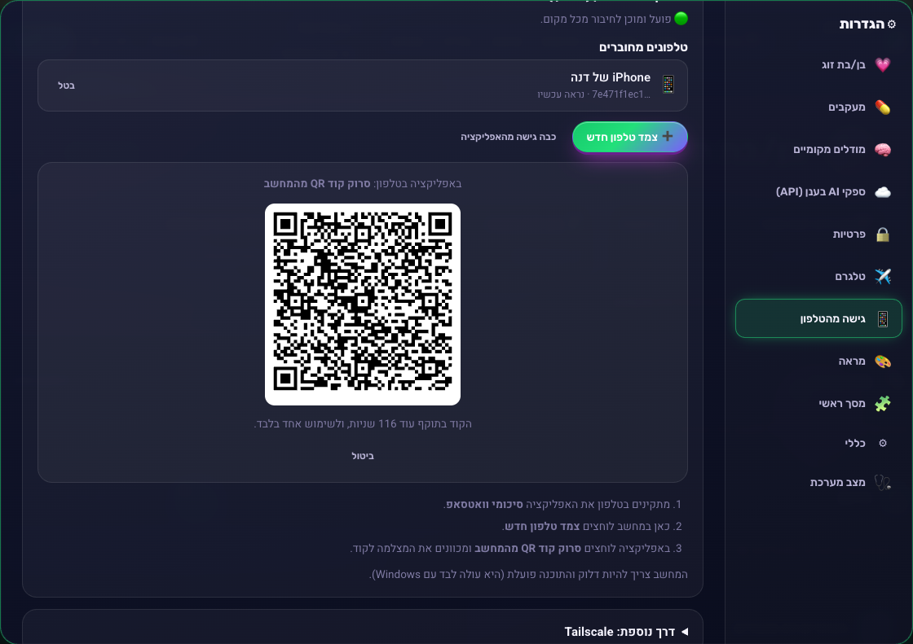</p>

**בטלפון:**

1. פותחים את האפליקציה **סיכומי וואטסאפ** ולוחצים **"📷 סרוק קוד QR מהמחשב"**.
2. מאשרים גישה למצלמה, ומכוונים אותה לקוד שעל המסך של המחשב.
3. זהו. האפליקציה נפתחת ישר לתוכנה, ובכל פעם הבאה היא תיפתח ישר לשם.

<p align="center">
  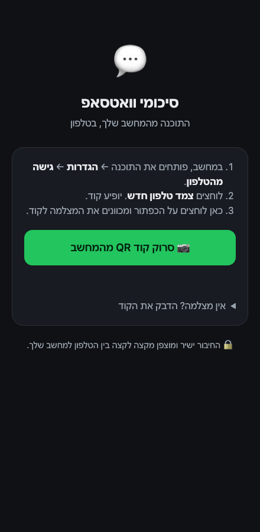
  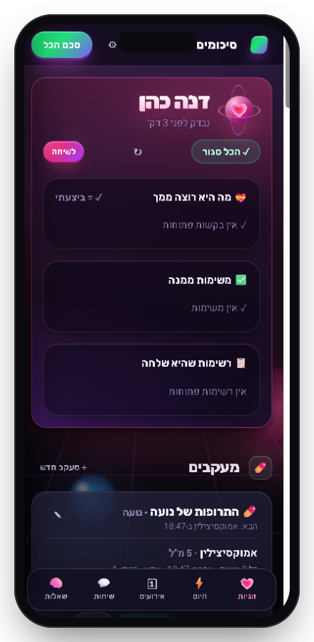
</p>

כל הטלפונים שצימדת מופיעים במחשב, באותו מסך. לידם רואים אם הם מחוברים עכשיו, ויש כפתור **"בטל"** שמנתק טלפון מיד (למשל אם הטלפון אבד).

<p align="center">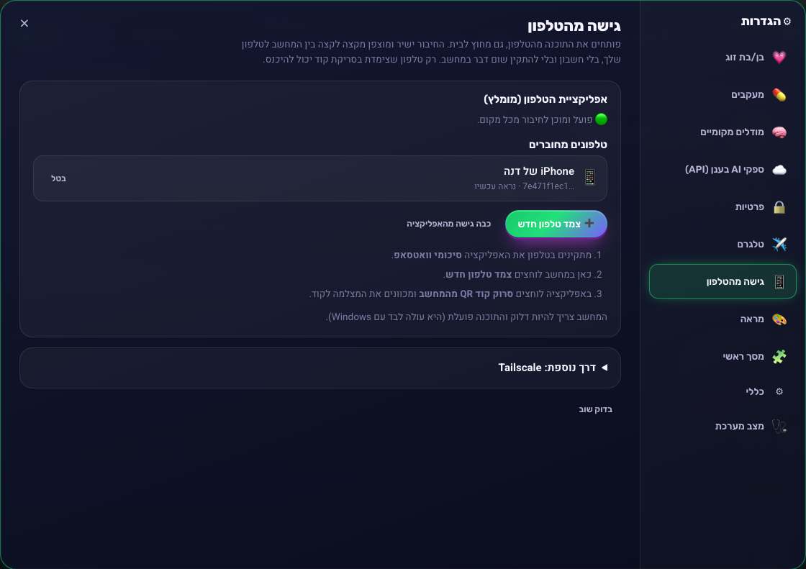</p>

**כשהמחשב לא זמין** (כבוי, במצב שינה, או בלי אינטרנט), האפליקציה מציגה הודעה ומנסה להתחבר שוב לבד. יש בה כפתור **"נסה שוב"**, וכפתור **"החלף מחשב / נתק חיבור"** כדי לצמד את הטלפון למחשב אחר.

<p align="center">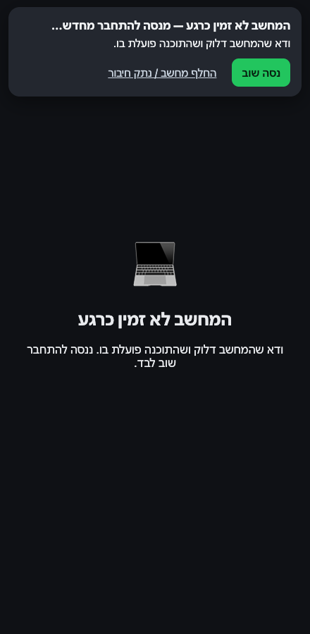</p>

**אם זה לא עובד:**
- המחשב צריך להיות **דלוק** והתוכנה פועלת (היא עולה לבד עם Windows). מחשב במצב שינה לא עונה.
- במחשב, במסך "גישה מהטלפון", צריך לראות **🟢 פועל ומוכן לחיבור מכל מקום**. אם כתוב משהו אחר, לוחצים **"בדוק שוב"**.
- אם כתוב "הקוד פג" או "הקוד כבר לא בתוקף": לוחצים שוב **"צמד טלפון חדש"** וסורקים את הקוד החדש.
- אם האפליקציה כותבת שהמחשב ביטל את הגישה: מצמדים מחדש מהמחשב.

### דרך נוספת: Tailscale (בלי אפליקציה)

מי שכבר משתמש ב-**Tailscale** (אפליקציה חינמית שיוצרת "רשת פרטית" בין המכשירים שלך) יכול להמשיך לפתוח את התוכנה בדפדפן של הטלפון. במסך "גישה מהטלפון" פותחים את **"דרך נוספת: Tailscale"**, והמסך מראה בכל רגע מה כבר עשית ומה השלב הבא.

**במחשב:**

1. לוחצים על **"הורדת Tailscale"**, מורידים את הגרסה ל-Windows ומתקינים כמו כל תוכנה.
2. בסוף ההתקנה נפתח דף התחברות. מתחברים עם **חשבון Google** (או Microsoft / Apple). זה בחינם. **זכרו באיזה חשבון התחברתם.**
3. חוזרים לתוכנה ולוחצים **"בדוק שוב"**, ואז **"📱 הפעל גישה מהטלפון"**.
4. **רק בפעם הראשונה:** ייתכן שיופיע כפתור **"פתח את דף האישור"**. לוחצים עליו, בדף שנפתח לוחצים **Enable**, וחוזרים ללחוץ שוב "הפעל".
5. מופיעה כתובת שמתחילה ב-`https://` ונגמרת ב-`.ts.net`. זו הכתובת של התוכנה שלך. אפשר ללחוץ **"שלח לי בטלגרם"** כדי לקבל אותה בטלפון בלי להקליד.

**בטלפון:**

1. מתקינים את האפליקציה **Tailscale** (מ-Google Play באנדרואיד, או מה-App Store באייפון).
2. פותחים אותה ומתחברים **עם אותו חשבון בדיוק** שהתחברתם איתו במחשב, ומאשרים את בקשת ה-VPN.
3. פותחים את **Chrome** (באנדרואיד) או **Safari** (באייפון) ונכנסים לכתובת שקיבלתם.
4. כדי שיהיה אייקון כמו אפליקציה רגילה: בתפריט הדפדפן בוחרים **הוספה למסך הבית**.

## פרטיות ובטיחות

- **ההודעות נשמרות רק במחשב שלך.** אין שרת של התוכנה ואין חשבון. שום דבר לא נשלח למפתחים.
- **קריאה בלבד:** הקוד שמתחבר לוואטסאפ חסום משליחת הודעות, וזה נבדק בבדיקות אוטומטיות.
- **מצב פרטיות** (הגדרות ← פרטיות):
  - **מקומי בלבד:** שום טקסט לא יוצא מהמחשב.
  - **משולב:** סיכומים כבדים יכולים לעבור לספק ענן, רק לפי ההרשאות שנתתם.
  - **ידני:** ענן רק כשאתם מבקשים עכשיו (שאלה או סיכום מלא). כל השאר נשאר במחשב.
- לכל שיחה אפשר לסמן **"מקומי בלבד"**, ושיחות פרטיות נשלחות רק לספק שסימנתם אצלו שמותר.
- **הגישה מהטלפון** פתוחה רק לטלפונים שצימדת בסריקת קוד (או, דרך Tailscale, רק לחשבון שלך), בחיבור מוצפן מקצה לקצה. התוכנה לא פתוחה לאינטרנט.
- **מהטלפון אי אפשר לשנות הגדרות רגישות:** מפתחות AI, בוט הטלגרם, קישור הוואטסאפ, הגישה מהטלפון עצמה ומחיקת נתונים. את אלה משנים רק במחשב.
- **מפתחות ה-API** נשמרים רק במחשב, ונשלחים רק לכתובת שהם נשמרו בשבילה.
- **גיבוי אוטומטי** של קובץ הנתונים פעם ביום (נשמרים 7 אחרונים).

<p align="center">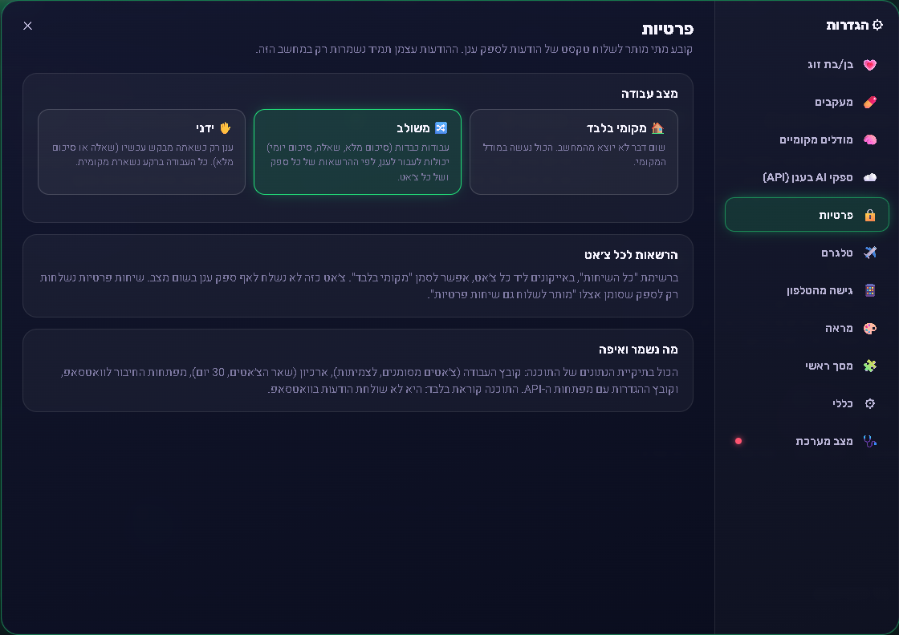</p>

## התאמה אישית

- **מראה:** כהה / בהיר / לפי Windows, צבע הדגשה, גודל טקסט, וכיבוי אפקטים (למחשבים חלשים).
- **מסך ראשי:** בוחרים אילו חלקים יופיעו, באיזה סדר, ומה יופיע רק כשיש בו משהו חדש.

<p align="center">
  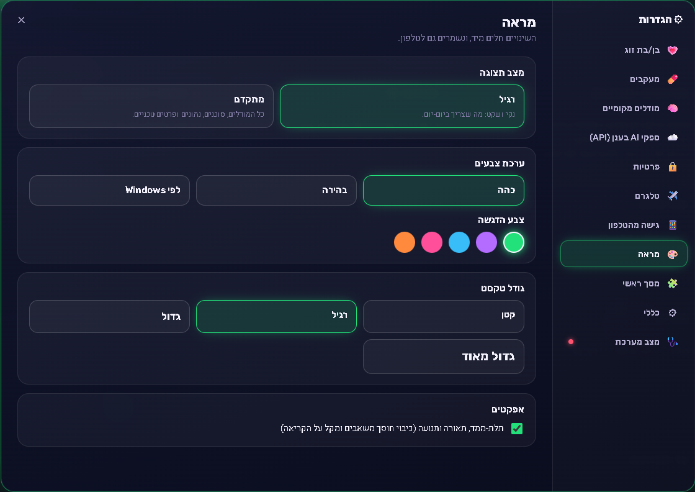
  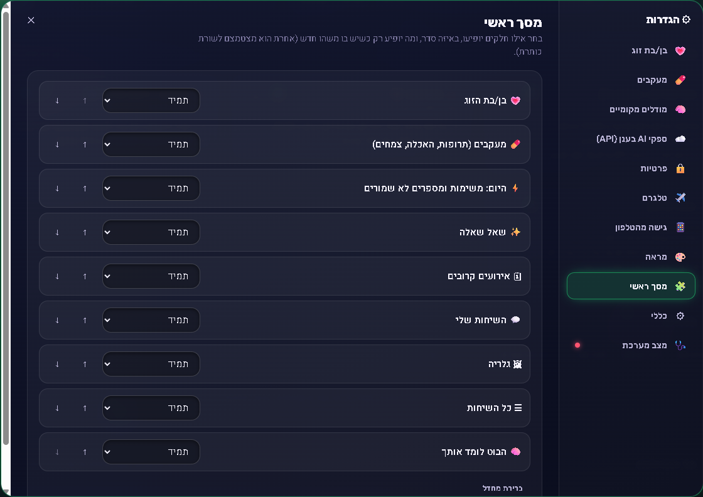
</p>

## כשמשהו לא עובד

הגדרות ← **מצב מערכת**. המסך מראה מה עובד ומה לא, ולכל בעיה יש כפתור שמתקן אותה או לוקח למקום הנכון.

<p align="center">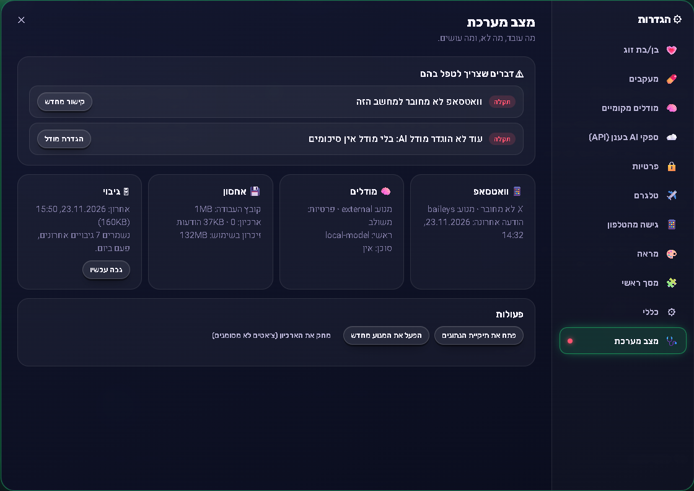</p>

**שאלות נפוצות**

- **"וואטסאפ לא מחובר":** במצב מערכת לוחצים "קישור מחדש" וחוזרים על שלב 2.
- **אין סיכומים:** בדקו בהגדרות ← מודלים מקומיים שיש מודל פעיל, או שהוגדר ספק ענן.
- **התוכנה לא עלתה אחרי הפעלה מחדש של המחשב:** לחיצה ימנית על האייקון ליד השעון ← לוודא ש"הפעל עם Windows" מסומן.
- **איפה הנתונים?** הגדרות ← מצב מערכת ← "פתח את תיקיית הנתונים".

## הסרה

הגדרות של Windows ← **אפליקציות** ← **WhatsApp Summary** ← הסרה. כדי למחוק גם את הנתונים, מוחקים את התיקייה `%APPDATA%\WhatsApp Summary`. ובטלפון: וואטסאפ ← מכשירים מקושרים ← מנתקים את המחשב.

</div>

---

## Technical notes (English)

A Windows desktop app (Electron shell + Node engine) that reads WhatsApp through a **read-only** layer on
[Baileys](https://github.com/WhiskeySockets/Baileys), keeps everything in local SQLite files, and summarizes the chats
the user marks with a local model (built-in llama.cpp, LM Studio, Ollama) or an OpenAI-compatible cloud API.

### Build from source

Requires Node.js 20 or newer on Windows, and [Rust](https://rustup.rs) (stable) for the phone bridge.

```bash
npm install
```

```bash
cd wa && npm ci --ignore-scripts
```

```bash
npm run build:p2p
```

```bash
cd app && npm install && npm run dist
```

`npm run dist` collects the engine into `build/engine` (`scripts/build-engine.js`), including `p2p-bridge.exe`, and builds
the installer into `dist/`. Instead of building the bridge yourself you can download it from the `p2p-bridge` GitHub
Actions run and point `P2P_BRIDGE_EXE` at it. The phone app has its own guide: [`mobile/README.md`](mobile/README.md).

### Tests

```bash
npm test
```

```bash
cd wa && npm test
```

```bash
cd app && npm test
```

```bash
npm run test:p2p
```

```bash
cd mobile/src-tauri && cargo test
```

The phone-app tests drive the real bridge, so build it first (`cargo build` in `p2p-bridge/`).

### Layout

| Path | What |
|---|---|
| `app/` | Electron shell: window, tray, autostart, engine supervisor |
| `index.js` | the engine: message handling, summaries, partner card, care trackers, reminders, backups |
| `web.js`, `ui.html`, `public/` | local dashboard server (127.0.0.1 only) and its UI, settings window and tracker cards |
| `db.js` | SQLite storage (work database) |
| `wa/` | read-only WhatsApp layer on Baileys (pinned version) and the 30-day archive |
| `localai.js` | built-in local AI: hardware scan, live model catalog from Hugging Face, verified downloads, llama.cpp servers |
| `providers.js`, `router.js` | cloud providers with privacy rules; small "agent" model for simple jobs |
| `care.js`, `feeding.js` | trackers (medicines, feeding, pets, plants) and the meal-message parser |
| `p2p.js` | phone access through the built-in bridge: starts and supervises `p2p-bridge`, pairing, devices |
| `p2p-bridge/` | Rust + [Iroh](https://iroh.computer): QUIC/TLS 1.3 tunnel from paired phones to the dashboard ([details](p2p-bridge/README.md)) |
| `mobile/` | phone app (Tauri v2, Android + iOS): QR pairing, local proxy, the dashboard in a WebView ([details](mobile/README.md)) |
| `remote.js` | the other way: phone access through `tailscale serve` (only the owner's Tailscale login is let in) |
| `scripts/build-engine.js` | collects what the installed app needs into `build/engine` |

### Security model

- The dashboard listens on 127.0.0.1 only. Requests must carry an allowed `Host` (blocks DNS rebinding), non-GET
  requests must be same-origin JSON (blocks CSRF). Phone access goes through `tailscale serve`, and only the
  owner's Tailscale login (`WEB_ALLOWED_TS_USER`) is accepted. Any relayed request (a `*.ts.net` Host or
  forwarding headers) counts as remote whatever its `Host` says, is refused while phone access is off, and can
  never change settings that are limited to the computer itself.
- Built-in phone access: `p2p-bridge` accepts Iroh connections (QUIC + TLS 1.3, end to end encrypted, relays never
  see content) only from phone keys in its allowlist (`p2p/paired_devices.json`). A phone is added by scanning a QR code
  with a one-time token that expires after 2 minutes. For every request the bridge drops any proxy/identity headers the
  phone sent, refuses a `Host` that is not the phone's own loopback, and adds `X-Remote-Peer-Id` (the key proven by the
  handshake) and `X-P2P-Proxy-Secret` (made fresh on every engine start and passed to the bridge in its environment only).
  `web.js` treats such requests as remote: wrong or missing secret = refused, phone access off = refused, and they
  cannot change computer-only settings (AI keys and providers, Telegram, WhatsApp linking, phone access, AI installs,
  deleting data). Revoking a phone closes its open connections at once.
- The phone app serves the dashboard to its WebView from `127.0.0.1` on the phone. Because other apps on the phone can
  reach that address too, the app's proxy requires its exact `Host` and a per-launch HttpOnly cookie that only the
  WebView receives, and strips that cookie before anything leaves the phone. Only the bundled pairing screen can call
  the app's own commands; the dashboard page cannot.
- Secrets (API keys, Telegram token, WhatsApp login keys, the bridge's and the phone's Iroh keys) live in per-user data
  folders, never in the repository.
- Privacy mode `local` blocks every request to a non-local model, including the main model and cloud transcription.

### Notes

This is a personal project and is not affiliated with WhatsApp, Meta, Telegram, Tailscale or n0 (Iroh). It uses an unofficial
client library (Baileys); using unofficial clients may be against WhatsApp's terms of service, so use it at your own risk.
